<a href="https://blueprintagencymkt-droid.github.io/">
  <picture>
    <source media="(prefers-color-scheme: dark)" srcset="assets/banner-dark.svg">
    
  </picture>
</a>

### Desenhamos franquias.

A **BluePrint** une branding estratégico, Design Thinking e arquitetura personalizada para empreendedores que querem marcas consistentes, escaláveis e emocionalmente envolventes. A planta da marca e a planta da loja, na mesma medida: φ = 1,618.

**[Ver a planta se levantar →](https://blueprintagencymkt-droid.github.io/)**

| | Pilar | O que fazemos |
|---|---|---|
| `01` | **Design Thinking** | Abrimos o que parecia fechado: imersão, entrevistas e protótipo antes do primeiro traço. |
| `02` | **Branding** | Revelamos o que estava dentro: plataforma, identidade, voz e manual. |
| `03` | **Arquitetura** | Damos forma ao invisível: layout, fluxo e vitrine prontos para a 100ª unidade. |

```
REF. BP-GH · ESCALA 1 : 1,618 · ESPAÇO 3 · 5 · 8 · 13 · 21 · 34 · 55 · 89 · CURITIBA · PR
```

**Juntos, tiramos ideias do papel.**
[blueprintlabs.space](https://blueprintlabs.space) · [curitiba@blueprintlabs.space](mailto:curitiba@blueprintlabs.space?subject=%5BBluePrint%5D%20Novo%20projeto)
